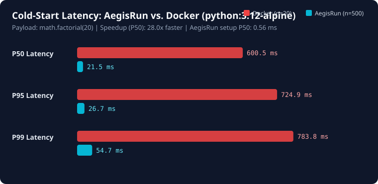

# `benchmarks/` — Security Red-Team Suite & Performance Benchmarks

Reproducible adversarial security verification, Docker cold-start comparison, and `k6` orchestrator load testing scripts for AegisRun.

---

## Contents

- [`security_redteam.py`](security_redteam.py): 7-vector live containment test suite + post-suite host leak audit (`mounts=0`, `cgroups=0`).
- [`vs_docker_bench.py`](vs_docker_bench.py): Compares AegisRun sequential/concurrent latency against `docker run` (`python:3.12-alpine`, `runc`) and generates [`results/vs_docker_summary.md`](results/vs_docker_summary.md) + [`results/cold_start_comparison.svg`](results/cold_start_comparison.svg).
- [`load_test.js`](load_test.js): `k6` high-concurrency mixed workload (200 VUs, 70% unique compute, 20% idempotent retries, 10% OOM probes) verifying Redis idempotent replay latency and 0% HTTP 5xx errors.

---

## 1. Adversarial 7-Vector Red-Team Suite

```bash
# With daemon-rs and control-go running (or via Makefile):
make redteam
# Or custom endpoint:
python benchmarks/security_redteam.py --url http://localhost:8080 --api-key aegis-dev-token
```

| Vector | Attack Simulation | Expected Containment |
| :--- | :--- | :--- |
| 1. Fork Bomb DoS | Repeated `os.fork()` loop | Blocked by cgroup `pids.max`; reaped via `cgroup.kill` |
| 2. Memory Exhaustion | `512 MiB` byte allocation under `128 MiB` cap (`memory.swap.max=0`) | Kernel OOM kill -> `SandboxOOMError` (`OOM_KILLED`) |
| 3. Credential Read & PID Inspection | `open('/etc/shadow')` & `/proc/1/cmdline` | `PermissionError` (`UID=10000`), PID 1 isolated to sandbox process |
| 4. Syscall Escape (`mount`) | Raw `libc.mount(...)` via `ctypes` | `SIGSYS` via `seccomp-bpf` -> `SandboxSecurityViolationError` |
| 5. Rootfs RO & `tmpfs` Cap | Write to `/` (`EROFS`) and fill `/tmp` (`tmpfs` `32 MiB`) | Rootfs fails `EROFS`; `/tmp` caps write with `ENOSPC` |
| 6. Egress Network Block | TCP connect to `1.1.1.1:80` | Blocked immediately by `CLONE_NEWNET` (`ENETUNREACH`) |
| 7. Output Flood DoS | Unbounded `64 KiB` stdout loop | Killed at `4 MiB` by `io_streamer` flood guard |

---

## 2. Cold-Start Comparison (`vs_docker_bench.py`)

Measured results recorded in [`results/vs_docker_summary.md`](results/vs_docker_summary.md):

- **Sequential P50**: **21.45 ms** (`P95 = 26.70 ms`, `P99 = 54.71 ms`, `Mean = 22.84 ms`) vs Docker (`runc`) **600.52 ms** (**28.0x faster**)
- **Concurrent (8 workers) P50**: **33.32 ms** (`P95 = 64.86 ms`, `P99 = 114.07 ms`) vs Docker **1819.97 ms**
- **Kernel Setup Overhead (P50 / P95)**: `555 us` / `829 us`
- **Per-Sandbox Peak Cgroup Memory (P50)**: `3.24 MiB`



```bash
make bench
# Or directly:
python benchmarks/vs_docker_bench.py --aegis-iterations 500 --docker-iterations 20 --concurrency 8
```

---

## 3. High-Concurrency `k6` Load Test (`load_test.js`)

Recorded run (200 VUs, 15s, `2757` iterations / `2761` HTTP requests):

- **Checks Passed**: **100.00%** (`8271 / 8271`)
- **HTTP 5xx & Failed Requests**: **0.00%** (`0 / 2757` 5xx; `0 / 2761` failed)
- **Redis Idempotent Replay Latency**: med `855.7 us`, avg `936.87 us`, P90 `1.14 ms`, P95 `1.29 ms` (`< 3 ms` threshold)
- **Unique Execution Latency**: avg `107.78 ms`, med `74.53 ms`, P90 `266.33 ms`, P95 `305.94 ms`

```bash
k6 run benchmarks/load_test.js \
  -e AEGIS_CONTROL_URL=http://localhost:8080 \
  -e AEGIS_API_KEY=aegis-dev-token
```
